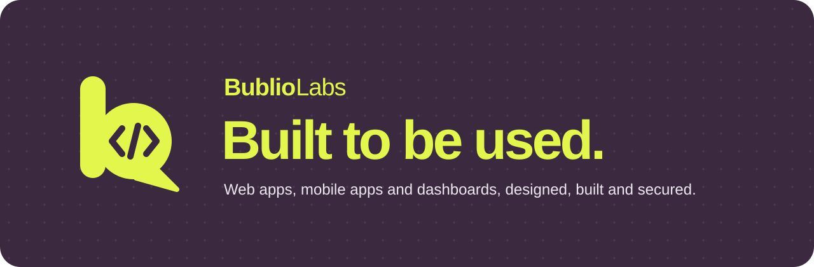
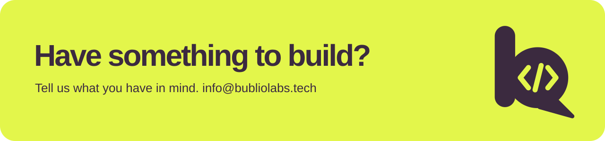

  

  
  
  

## Hi, we're Bublio Labs

We design, build and secure **web apps, mobile apps and dashboards**. Founded in 2026, we work remotely from
Quezon City, Philippines.

> Anyone can build an app with a single prompt now.
> We make sure yours is secure, solid and ready for the people who use it.

## What we do

| | |
| --- | --- |
| **Web development** | Websites and web apps that load fast, look sharp and work in every browser. |
| **Mobile app development** | Apps for iOS and Android that feel at home on the phone in your pocket. |
| **Dashboards and internal tools** | Turn scattered spreadsheets and systems into one clear view your team can trust. |
| **Product design** | Research, UX and UI design that shapes the product before a line of code. |
| **Maintenance and support** | Keep the apps we build secure, up to date and running smoothly after launch. |
| **Technical audits** | A clear, independent look at an app you already have, and what to fix first. |

## How we work

**We build. You approve. We secure it and ship.**

1. **Design.** We shape the product with you and test it with the people who will use it.
2. **Build.** The same team turns the design into working software, so nothing gets lost in handoff.
3. **Ship.** We launch, then stay on for 14 days of free support while it settles in.

## What we believe

- **Made for real people.** We test with the people who will use it, early and often.
- **Fast everywhere.** Quick on a mid-range phone and a patchy connection, not just on our own laptops.
- **Clear over clever.** If someone has to stop and think about how to use it, we still have work to do.
- **Easy to change.** Clean, documented code, so your product can grow without starting over.

## Tools we use

**Web**

  
  
  
  
  
  
  
  
  
  
  
  

**Backend**

  
  
  
  
  
  
  
  
  

**Mobile**

  
  
  
  
  

**Databases**

  
  
  
  
  
  
  

**Cloud and hosting**

  
  
  
  
  

**Design and workflow**

  
  
  

## Work with us

Projects start at **₱20,000**. Try the [cost estimate](https://bubliolabs.tech/estimate) for a price range in a
minute. Nonprofits and schools get **20% off**.

  

  Built to be used. · <a href="https://bubliolabs.tech">bubliolabs.tech</a> · © 2026 Bublio Labs

